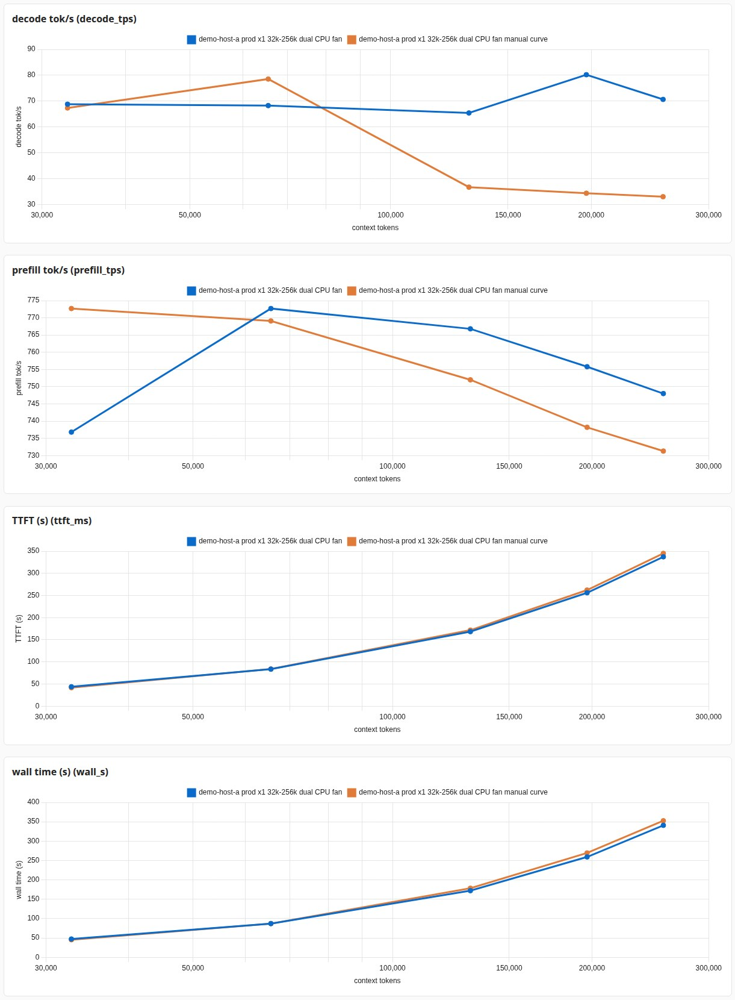
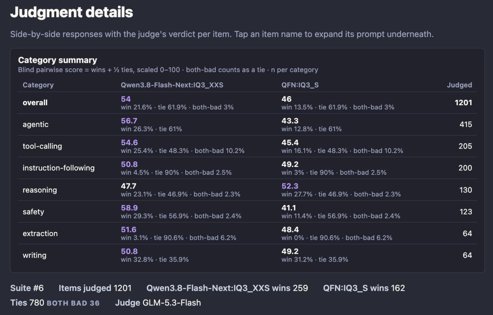

# Arcturos

**Local-first LLM benchmarking & evaluation dashboard**

Arcturos benchmarks LLM inference servers and evaluates their outputs — all data stays in a local SQLite file you own. Compare, replay, and judge every run.



*The Compare view: decode / prefill throughput, time-to-first-token and wall time, plotted per context length for any set of runs.*



*The Judgment details view: per-category pairwise scores with win / tie / both-bad rates, judged counts, and the aggregate wins for each side.*

## What it does

- **Benchmark** any OpenAI-compatible (or llama.cpp native) inference server — decode tok/s, prefill tok/s, TTFT, wall time, MTP/speculative acceptance, parallel streams, at multiple context lengths
- **Compare** runs side-by-side with charts, pinned baselines, per-metric deltas, and integrated A/B diff tables
- **Evaluate** suites (single- and multi-turn) with blind pairwise A/B judging — position swapping with both orders stored, an optional reference-guided prompt variant that renders machine-check references to the judge (catches "both answers wrong"), an explicit both-bad outcome scored as a draw with its own `both_bad_rate`, and breakdowns by dimension, category, and model pair — plus a head-to-head pair lens for any two models
- **Kick off flexibly** — replay a whole suite, one side of a pair from a single run, or mix any two recent runs into one judgment job; combined jobs can replay both models and judge them in one go
- **Per-model reasoning controls** — reasoning effort (`minimal` → `max`) and thinking-token budget sent with every eval and bench call
- **Private suites stay private** — suite definitions that must never leave your machine go in gitignored `qa/suites-private/` and live only in your local database; the repo ships the build/sweep tooling, never the suite contents
- **CSV export** of runs, comparisons, eval results, judgments (including verdict detail), and reports
- **Append-only storage** — measurement rows are never mutated; visibility and naming are separate, reversible layers

### Quick start

```bash
git clone https://github.com/waxinz/arcturos.git
cd arcturos
./start.sh
```

That's it — `start.sh` provisions everything (creates the venv, installs dependencies) and installs Arcturos as a **systemd user service** (auto-starts, survives logouts; enable boot-time start with `sudo loginctl enable-linger $USER`). Without systemd (macOS, containers) it falls back to running in the foreground.

Other commands: `./start.sh run` (foreground), `./start.sh remove` (uninstall).

Open `http://localhost:24816` — the top navigation walks you through the three sections:

| Section | Pages |
|---|---|
| **Benchmarks** | Start · Compare |
| **Evals** | Create · Run · Results · Judgments · Reports |
| **Settings** | Models · Baselines |

Eval replays and judge jobs run as live jobs with per-item progress and an operator stop button; run and judgment drill-downs expand each row to the full prompt (text and images), response, and verdict.

### Configuring defaults

Defaults live in `arcturos.toml` (committed template). To point your install at your own inference server, create `arcturos.local.toml` alongside it — it is gitignored, so your hostnames and keys never leave your machine:

```toml
[bench]
server_url = "http://your-inference-host:8000"
model = "your-model-name"

[demo]
live_targets = ["http://your-inference-host:8000"]
judge_url = "http://your-judge:4000/v1"
```

Environment variables override everything (`ARCTUROS_BENCH__SERVER_URL=…`, `ARCTUROS_DEMO__JUDGE_URL=…`). API keys are sent per-request only; nothing is stored.

### Demo data

`scripts/seed_demo.py` seeds synthetic benchmark rows and eval suites end-to-end so the dashboard has something to show before your first real run:

```bash
venv/bin/python scripts/seed_demo.py
```

## Tests

```bash
venv/bin/python -m pytest tests -q
```

401 tests: append-only storage semantics, schema migrations, API contracts, judge parsing (including truncated-output guards), report math, and static-page wiring.

## License

MIT
